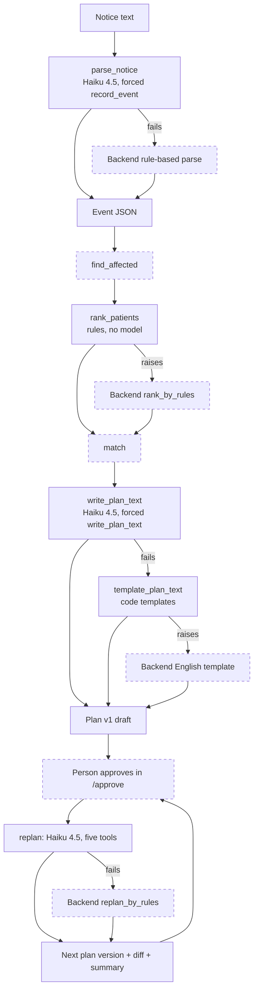

# AI lane: design

This describes the code on `main` in `backend/lumen/ai/`. Requirement numbers refer to `requirements.md`.

**Bedrock status.** The team account's Bedrock quota was zero while this lane was built (a Haiku 4.5 quota request was still open with AWS Support). A live call from the lane returned `ThrottlingException: Too many tokens per day`. Every module is therefore tested offline with a stubbed `bedrock.converse`, and **no live Bedrock reply has been verified**: prompt behaviour, latency and the model's real tool-use output are unchecked. The Lambda reports each step that fell back in `ai_sources`.

## Flow

Solid boxes are AI-lane code; dashed boxes are Backend code that the router calls. Each AI step has a fallback.

The router (`lambda_function.py`, Backend) wraps parse (20 s), text (25 s) and re-plan (45 s) in `with_deadline`; when a step raises or runs past its deadline, it logs `fallback=True` with the reason and uses the fallback. It caps the notice at 20,000 characters and the instruction at 500.

## Models and configuration

| Module | Model variable | Value today |
| -- | -- | -- |
| `parse.py` | `BEDROCK_MODEL_FAST` | `us.anthropic.claude-haiku-4-5-20251001-v1:0` |
| `text.py` | `BEDROCK_MODEL_FAST` | same |
| `replan.py`, `smoke.py` | `BEDROCK_MODEL_ID` | same (README: Haiku 4.5 "for now"; Sonnet 4.6 waits on quota, 5.5 is not available to the account) |
| `rank.py` | none | rules only |

Region and credentials come from the Lambda environment (`AWS_REGION` or `AWS_DEFAULT_REGION`, us-east-2 for the team account). Model IDs are never hard-coded.

## bedrock.py (Requirement 5)

`converse(model_id, system, messages, tools=None, tool_choice=None)` builds the Converse request, forces a tool when `tool_choice` names one (auto otherwise), and returns `{stop_reason, text, tool_uses, usage, message}`. The boto3 client is created on first use and cached; it allows one SDK attempt, because the wrapper owns retries: one retry after 0.25 s for throttling, service-unavailable, internal-server and model-not-ready errors, none for other `ClientError`s. `ParamValidationError` becomes a bare `ValueError` so request details are not kept as context. One INFO line per call logs model ID, token counts and milliseconds. `attempt_guard(callback)` is a context variable that runs a caller's budget check before each attempt, including the retry; `text.py` and `replan.py` use it. `smoke.py` (`python -m lumen.ai.smoke`) is a manual live check that prints one reply and the token counts.

## parse.py (Requirement 1)

Flow: check input, read `BEDROCK_MODEL_FAST`, call `converse` with the system prompt `prompts/parse.md`, the notice as a JSON user message `{"notice_text": ...}`, and the one tool `record_event`, forced.

- **Tool schema.** A flat copy of `contracts/schemas/event.schema.json` without the router-set fields, embedded in `parse.py` because the Lambda package has no `contracts/`. A test pins it to the contract.
- **Validation** (`_validate`, `_time`). Exactly one `record_event` call; all six keys; non-empty `event_id` and `area_name` that appear in the notice; `notice_type` in the allowed set; each time matches the contract pattern, then `datetime.fromisoformat`; `end` after `start`. The only retryable error is the internal `_Invalid(ValueError)`.
- **Retry.** On `_Invalid`, one more call with the same message plus `validation_error`; a second `_Invalid` propagates as `ValueError`. Errors from `converse` are not caught, so the router sees them and falls back to `lumen.notice.parse_fallback`.
- **Output.** The six validated keys (strings stripped) plus the input as `source_text`. The router replaces `source_text` anyway and sets `parse_source`.

## rank.py (Requirement 2)

`rank_patients(affected, patients, rules, drive=None)` computes ten boolean facts per patient (`session_in_window`, `session_within_36h`, `heart_failure`, `missed_recently`, `paratransit`, `home_in_outage`, `no_car`, `lives_alone`, `wheelchair`, `limited_english`), adds the `rules.json` points for those that apply (`urgency` and `difficulty` groups), and sorts by the key in Requirement 2.3. Only patients with an affected session are ranked. There is no model call, so no validation or fallback is needed in this module; if it raises, the router uses Backend's `rank_by_rules`, written to give the same output (Rule 3).

## text.py (Requirement 3)

`write_plan_text(plan, clinics, langs, only_ids=None)` returns a deep copy.

1. **Facts.** `_facts` builds per-row facts without names or homes. The "when" and pickup strings are formatted in code per language (English, Spanish and Chinese weekday, month and day-part names), so the model only copies them. `reason_text` comes from `_reason` (reason codes to phrases, at most 20 words).
2. **Calls.** Rows go in batches of 10 on up to 4 threads under a shared budget: 30 attempts and 20 seconds, counted through `attempt_guard`, so SDK retries count too. The prompt is `prompts/text.md`; the tool `write_plan_text` is forced.
3. **Validation** (`_validated`, `_row_error`, `_message_error`). The checks listed in Requirement 3.5, per row, so one bad row does not discard the others.
4. **Retry and split.** A batch with errors is retried once with the error codes; a batch that ends at `max_tokens` is split in two.
5. **Fallback inside the module.** A row that still fails gets `_template(facts)` (the code-built message in each language, itself checked by the same validator) and a warning with the patient ID. If every batch ended in a provider error (`ClientError`, `BotoCoreError`, `TimeoutError`) and no row succeeded, the first error is re-raised.
6. **Summary.** `_summary` counts early sessions, transfers and hospital rows and the paratransit rides to book today; the model writes no summary.

`template_plan_text` runs only steps 1, 5 (templates) and 6, with no model call. The router calls it when `write_plan_text` raises, and uses Backend's `text_fallback.fill` only if it raises too.

## replan.py (Requirement 4)

`replan(instruction, plan, tools, clinics)` is a bounded loop. The model sees the instruction, name-free rows and a clinic summary, and may call the five tools; the Backend functions in `tools` do all edits.

- **Context from the instruction.** `_known` records which clinics (by name or ID) and which patient IDs the instruction mentions, each slot's original open chairs, and any "(clinic) can only take N more" limits. An ambiguous or unknown clinic in a limit phrase raises `ValueError`.
- **Per-call validation** (`_validate`). Tool name, exact keys, types and patterns, IDs in the plan or clinics, the slot exists, the clinic or patient was mentioned, and `chairs` within the original open chairs. A refused call returns an error result to the model; nothing runs.
- **Failure tracking.** Failed mutations are remembered per target; a later success for the same target clears the entry. At the end, unrepeated failures raise `RuntimeError("partial re-plan")`, and all-failed raises `RuntimeError("all tool calls failed")`.
- **Finish.** `_finish` checks the "N more" totals, then runs `rerun_matching` and `diff_plans` through the tools if the model did not or the results are stale. The returned `plan` is the matching result, so it is always whole.
- **Summary.** `_summary` writes two sentences from the diff: the changed row count and clinic names, then new action counts with fixed wording. The model writes none.
- **Limits.** At most 6 model calls; a 40-second budget checked around every model call, tool call and Bedrock attempt. The router's own deadline is 45 s.

The model sees tool results through allow-lists (`_rows`, `_view`) and error text shorter than 200 characters; longer error text becomes "Tool failed".

## quality.py (Requirement 6)

A standard-library HTTP client (`urllib`) plus `jsonschema`. `run_once` makes the five calls, `check_ids`, `check_schema`, `check_messages` and `check_coverage` count defects on the plan from `/plan` and the plan from `/replan`, and `summarize`, `render_table` and `render_summary` produce the report. A run is clean when all five steps return 200 and every defect count is zero; a fallback step does not make a run unclean. The word and character limits are applied after removing the patient's name, because the HTTP responses have names filled in. Run it from `backend/` with `LUMEN_URL` and `DEMO_KEY` set.

## How failures show up

| Step | Label | Where |
| -- | -- | -- |
| Parse | `parse_source`: `bedrock` or `fallback` | on the event |
| Rank | none (rules only) | log line on fallback |
| Plan text | `ai_sources.text`: `bedrock` or `fallback` | on the plan; `fallback` covers both the template path and the English template, and the log says which (`source=template_plan_text` or `source=text_fallback`) |
| Re-plan | `ai_sources.replan`: `bedrock` or `fallback` | on the plan; `ai_sources.text` covers only the changed rows |

The contract allows only `bedrock` and `fallback` as `ai_sources` values. Every fallback logs `fallback=True` with `repr(exception)[:300]` in the router's CloudWatch line. The contract asks the UI to show a tag on each `fallback`; this lane does not build the UI.

## Tests

`backend/tests/`: `test_bedrock.py`, `test_parse.py`, `test_rank.py`, `test_text.py`, `test_replan.py` and `test_quality.py` for the AI lane (`test_rank_fallback.py` covers Backend's rank fallback). All use stubbed `converse` or a fake HTTP layer; none touches the network. Run `cd backend && python -m pytest -q`.

## Known limits

- No live Bedrock verification yet (see above).
- The operator's instruction is sent to Bedrock as typed.
- Rank has no model, by design; `reason_text` and summaries are code-built, so Bedrock affects only parsing, messages and the choice of re-plan tool calls.
