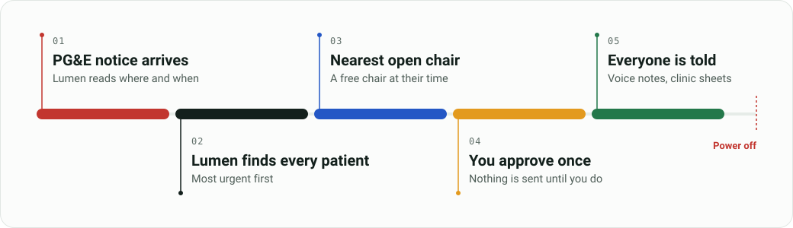

# Lumen

**Lumen plans dialysis care before a planned power shutoff. It turns a PG&E shutoff notice into a slot and a message for every affected patient, and one staff approval tells everyone.**

Built for Spark Hill Hackathon 2026 at SJSU, AWS track, by Group 23.

**Live demo: [main.d1eh2uukook6ji.amplifyapp.com](https://main.d1eh2uukook6ji.amplifyapp.com)**

Press **Try the live demo**, then **Run demo**. The console opens on Santa Clara County and replays a recorded run of the live system, so no key is needed.

## The problem

People on dialysis cannot skip treatment. Missed sessions are dangerous, and the risk grows with every day without care.

PG&E turns off power in fire weather with a Public Safety Power Shutoff (PSPS). The warning comes about two days ahead, and the shutoff can last days. When a clinic is inside the shutoff area, its staff must find every patient another chair before the power goes off. Today they do this by phone, one patient and one clinic at a time.

The cost of getting it wrong is known from past disasters:

* After Hurricane Sandy, patients who got dialysis early had **28% lower odds of dying** within 30 days.
* **92% of hospitals** said dialysis patients from other clinics arrived without their records.

<sub>Source: [ASPR TRACIE, Dialysis lessons learned from Hurricane Sandy](https://files.asprtracie.hhs.gov/documents/aspr-tracie-ta-dialysis-hurricane-sandy-lessons-learned-07015-508.pdf).</sub>

## What Lumen does



1. **Reads the notice.** It takes the PG&E notice and pulls out the shutoff area, start and end.
2. **Finds who is affected.** It finds the clinics that lose power and every patient with a treatment while the power is off.
3. **Ranks by risk.** Each patient gets a score for urgency (a treatment soon, heart failure, a recent missed treatment) and for how hard the move is (paratransit, no car, a wheelchair, living alone, limited English, a home that also loses power).
4. **Finds a slot.** Each patient gets an early treatment at their own clinic, or the nearest powered clinic with a free slot at their usual time. When nothing fits, the patient goes on a list for a staff phone call.
5. **Writes the messages.** Each patient gets a short message in their language with the day, time, clinic and ride pickup.
6. **Checks the plan.** It looks for full clinics, long gaps until the next treatment, missing hepatitis B tests, early pickups and other problems, and explains each one in a plain sentence.
7. **Waits for one approval, then tells everyone.** After staff approve, each patient gets a voice note and each receiving clinic gets the list of patients who will arrive. Replies come back, and staff see who still needs a call.

If something changes, staff type it in plain words, for example "DaVita Tully can only take 4 more", and Lumen updates the plan.

## Impact in the demo

The demo shutoff covers the east side of San Jose for about 42 hours. Three dialysis clinics lose power.

* **96 patients planned.** 17 come in early, 75 move to 7 other clinics, and 4 are flagged for a staff phone call.
* **60 of the 75 moves** are within an estimated 10-minute drive.
* **Messages in 4 languages:** English, Spanish, Chinese and Vietnamese.
* **Voice notes in 3 languages:** English, Spanish and Chinese.
* **Receiving clinics are told.** The 7 clinics and the hospital each get an arrival list with every patient's day, time, ride, language and hepatitis B test date.
* **Rides are flagged.** The plan lists the 14 paratransit rides to book today.
* **Fast.** The planning step for all 96 patients ran in under one second.

## How it is built

| AWS service | What it does in Lumen |
|---|---|
| **AWS Amplify** | Hosts the web app: the landing page and the console. Static files, no build step. |
| **Amazon Location Service** | Draws the map and traces road routes from each closed clinic to the clinics that take its patients. |
| **AWS Lambda** | One Python function is the whole API. It finds affected patients, ranks them, matches slots, writes messages, checks the plan, and records every approval and send. |
| **Amazon Bedrock** | Reads the PG&E notice into fields, rewrites plan-check findings as plain sentences, and turns typed changes into edits. The model is Qwen2.5-7B-Instruct, brought in with Bedrock Custom Model Import. |
| **Amazon S3** | Stores clinics, patients, rules, every plan version and the voice notes. Each plan change is a new version you can trace. |
| **Amazon Polly** | Reads each approved move aloud as a voice note in English, Spanish or Chinese. |

### AI reads and explains, rules decide, people approve

* **AI reads and explains.** The model reads the notice, rewrites the plan check in plain words, and reads typed changes. It never ranks a patient or picks a slot.
* **Rules decide.** Code ranks patients, picks slots, checks capacity, finds every problem in the plan and decides who gets a voice note. The model can reword a problem, but it cannot remove one or make it less serious. A typed change becomes a list of edits that code checks before it applies them.
* **People approve.** Nothing goes out until staff press **Approve and tell everyone**.
* **Names stay out of the model.** Code swaps patient names for IDs before any text reaches Bedrock.

## Repo map

* `frontend/prototype/` is the web app: landing page, console and map. Its [README](frontend/prototype/README.md) walks through every screen.
* `backend/lambda_function.py` is the API, one route per step.
* `backend/lumen/` holds the planning code: affected patients, slot matching, the plan check, approvals and sends, voice notes and storage.
* `backend/lumen/ai/` holds the Bedrock steps, the ranking rules and the message templates.
* `backend/tests/` holds the tests.
* `contracts/` holds the [API reference](contracts/api.md) and JSON schemas.
* `data/seed/` holds the seed data for the El Dorado County scenario.
* `scripts/` builds and checks the seed data and deploys the API.
* `docs/operations.md` has the [deploy steps](docs/operations.md).

## Run it locally

```bash
python3 -m http.server 5173 -d frontend/prototype
```

Open http://localhost:5173/ (use `localhost`: the map key allows only that host). Santa Clara replays the recorded run. A live run needs a demo key from the team. Backend tests run with `python -m pytest -q` in `backend/`, after `pip install -r backend/requirements-dev.txt`.

## Data and safety

* **All patient data is synthetic.** Names, homes, phone numbers and health details are made up.
* **Sends are simulated.** The PG&E notice, voice notes, clinic lists and replies are part of the demo. No message leaves Lumen.
* **Clinics are real.** Names, addresses and stations come from public CMS data. Open slots are simulated.
* **Drive times in the plan are estimates** from distance. The map draws real road routes.
* **The shutoff area is drawn for the demo.** It is not a PG&E map.
* **The rules are demo assumptions,** not clinical guidance.

## Team

Vi Huynh, Asthra Meadipudi, Zayd Bashir and Saieesha Marta (Group 23).
